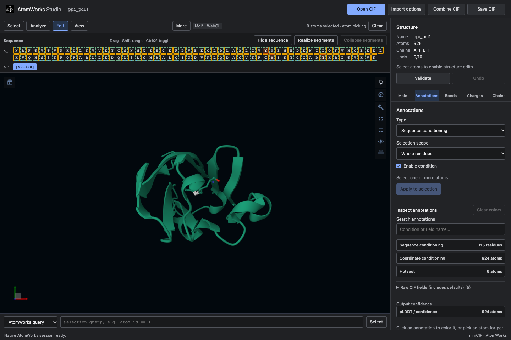
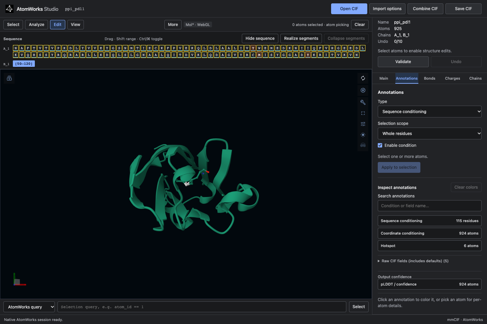
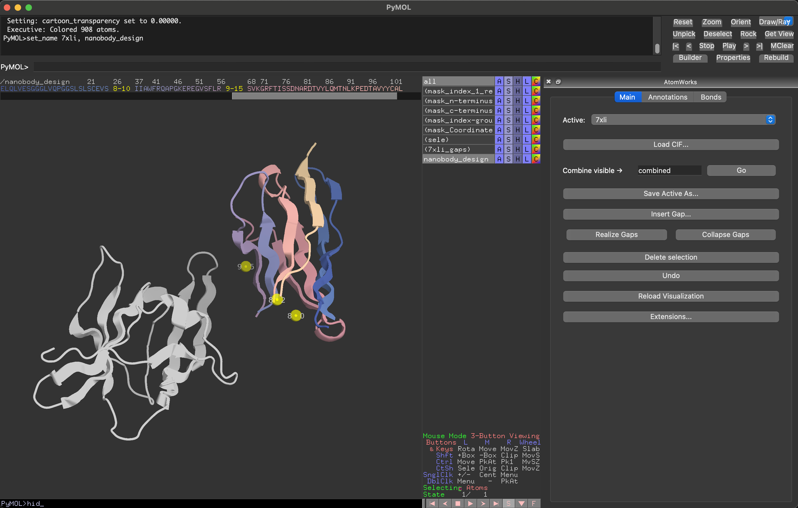

<h1 align="center">AtomWorks Studio</h1>

<p align="center"><b>Inspect, annotate and edit molecular structures in a browser, VS Code or PyMOL.</b></p>

<p align="center">
<a href="https://github.com/RosettaCommons/atomworks-studio/actions/workflows/ci.yaml"></a>
<a href="https://pypi.org/project/atomworks-studio/"></a>
<a href="https://pypi.org/project/atomworks-studio/"></a>
<a href="https://github.com/RosettaCommons/atomworks-studio/blob/main/LICENSE.md"></a>
<a href="https://github.com/astral-sh/ruff"></a>
</p>

<p align="center">
<a href="https://rosettacommons.github.io/atomworks-studio/v0.0.6/">Documentation</a> ·
<a href="https://rosettacommons.github.io/atomworks-studio/v0.0.6/INSTALLATION.html">Installation</a> ·
<a href="https://rosettacommons.github.io/atomworks-studio/v0.0.6/TUTORIAL.html">Tutorial</a>
</p>

<p align="center"></p>

Studio is a structure and annotation editor for [AtomWorks](https://github.com/RosettaCommons/atomworks)
annotated CIF files. Select atoms, attach conditioning annotations (sequence, coordinates, hotspots,
index groups and more), fix bonds and charges, protonate, edit chains and expandable segments, and save a
CIF that any Studio interface reopens. It is built for preparing inputs to structure-design models such as
[RFD4-Proteina](https://github.com/RosettaCommons/RFD4-Proteina). No model runtime or weights are needed.

## Features

- **One editor, three interfaces.** The browser, VS Code and native PyMOL share annotation definitions,
  editing operations, CIF storage and Undo.
- **Annotations you can see.** Pick a condition, apply it to a selection, and color or inspect the stored values.
- **Selections with AtomWorks queries.** Expressions such as `chain_id == 'A' & res_id > 50` work everywhere.
- **Structure edits with Undo.** Bonds, charges, pH-based protonation, chains, segments and validation.
- **Two renderers in the browser.** Mol* (WebGL) by default and Patinae (WebGPU), both bundled.
- **Design-ready examples.** Protein and small-molecule binders, antibody and nanobody CDRs, enzyme motifs,
  motif scaffolding, inverse folding and partial diffusion.
- **Optional Gradio host.** Adds generation controls around the same editor for hosted demos and Spaces.

## Install

Studio needs Python 3.12.

```bash
python -m pip install atomworks-studio
atomworks-studio
```

Open <http://127.0.0.1:8000/>. The guide is at <http://127.0.0.1:8000/guide/>. Mol* and Patinae are
included in the package; Node and Rust are only needed to build from source.

<table>
<tr>
<td width="50%"><b>Browser and VS Code</b><br>Run <code>atomworks-studio</code>, or install the VSIX from the
<a href="https://github.com/RosettaCommons/atomworks-studio/releases">releases</a> and run
<b>AtomWorks: Open Studio</b>. The extension starts its Python backend for you.</td>
<td width="50%"><b>PyMOL</b><br>Install the package in PyMOL's Python environment, run
<code>atomworks-studio-pymol install</code>, then open <b>Plugin → AtomWorks Studio</b>.
PyMOL and Qt come from your PyMOL installation.</td>
</tr>
</table>

## Use

Open a CIF, select atoms, and choose an annotation in **Edit → Annotations**. Inspect the stored values,
change bonds or charges, protonate, or edit chains and segments. **Save CIF** writes a file that opens in any
interface.

<p align="center"></p>

The PyMOL plugin offers the same controls natively, here on a nanobody design with a hotspot on the target:

<p align="center"></p>

See the [documentation](https://rosettacommons.github.io/atomworks-studio/v0.0.6/) for selection syntax, interface guides, Python and HTTP
integration, and development notes.

## Build from source

```bash
make bootstrap
make test
make build
make run
```

The RFD4 annotation definitions and license are bundled in source and release builds and verified against the
SHA-256 hashes in `providers/rfd4/UPSTREAM.toml`. See [provenance](https://github.com/RosettaCommons/atomworks-studio/blob/main/docs/PROVENANCE.md).

## License

BSD-3-Clause. See [LICENSE.md](https://github.com/RosettaCommons/atomworks-studio/blob/main/LICENSE.md).
