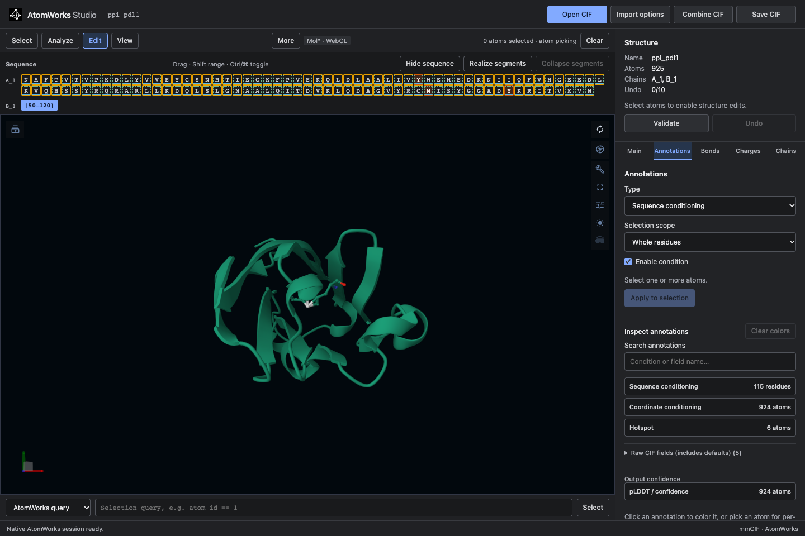
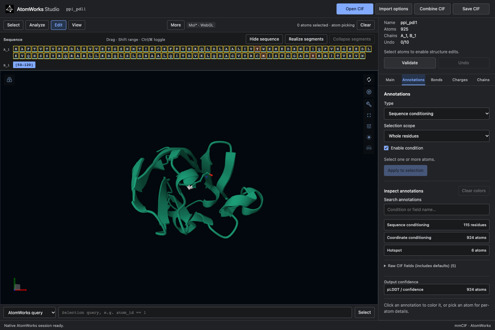

# Browser guide

The browser editor runs locally or on a shared server. The Studio API stores
the annotated structure; Mol* or Patinae renders it.



## Start the editor

With installed wheels, run `atomworks-studio`. See [installation](INSTALLATION.md).
From a source checkout:

```bash
make bootstrap
make run
```

Open <http://127.0.0.1:8000/>. It uses **Mol*/WebGL by default**, including when embedded in Gradio. Choose
Patinae from **Backend → Renderer**, or pin a renderer with a query parameter:

- <http://127.0.0.1:8000/?viewer=patinae> — Patinae using WebGPU
- <http://127.0.0.1:8000/?viewer=molstar> — Mol* using WebGL

Patinae and Mol* implement the same Studio actions. An explicit renderer choice is retained for later visits. A fatal Patinae
runtime failure still switches to Mol* to preserve the open document.

The editor stays visible beside the molecule, or below it in narrow windows.
Viewer menus and Escape do not hide it. **Backend** contains the renderer selector;
the command catalog appears there only when the renderer supports it.

## Load a structure

**Main → Structure → Reset conditions to defaults** resets all conditions on the
loaded structure, including saved targets and restraints. Atoms, coordinates,
bonds, chains, and structural edits stay in place. Selection, condition colors,
and temporary display changes are cleared. **Undo** restores the conditions.

Reloading the page restores your current editing session. To start over, reopen
the original CIF with **Open CIF**, or load the example again from **Main → Examples**.
**Main → Structure → Close structure** deletes the active server session and its
saved snapshot, then returns to an empty editor. Reloading or following an old
session link cannot reopen it. Your original CIF file is unchanged. Save CIF
first to keep your edits. If closing fails, the document stays open with an error.

Choose **Open CIF** and select a `.cif` or `.mmcif` file. **Import options**
controls:

- **Preset** — annotated CIF or RCSB preparation
- **Assembly** — one assembly, the first assembly, all assemblies, or asymmetric
  unit
- **Model** — one model or all models
- **Hydrogens** — keep or remove
- **Remove waters** — optional water filtering

Use **Combine CIF** to merge another file into the active document. The
**Main → Examples** panel includes a **Protein binder · PD-L1** example and
the eight NIM inputs: antibody, VHH, enzyme, motif, SAM binder, inverse folding,
partial diffusion, and unconditional design.
The same packaged catalog is used by the Gradio Space.

The fixtures are described in
[examples/README.md](https://github.com/RosettaCommons/atomworks-studio/blob/main/examples/README.md).

To make the protein-binder input from an unannotated PD-L1 CIF, open the target
and use **AtomWorks query** `chain_id == 'A'` to select it. In **Annotations**,
enable **Sequence**, reselect chain A, then enable **Coordinate**. Mark these six target
atoms as **Hotspot**: residue 56 CG and OH, residue 115 CG and SD, and residue
123 CD2 and OH. Then use **Main → Expandable segments** to add a new
protein chain B with a 50–120 residue segment. Save the CIF. These are the
conditions in the packaged example; the same controls work in PyMOL.

## Navigate and select

The sequence strip stays synchronized with the 3D view. Click a residue to
select it, use Ctrl/Cmd-click to toggle residues, and Shift-click to extend a
range. Choose atom, residue, or chain picking from the toolbar’s **Pick** control.

The command field supports:

- **AtomWorks query** selects atoms with expressions such as `atom_id == 1` or
  `has_bonds()`, in either renderer. Selection paths use the same mode:
  `sel('*/*/*/CA')` selects alpha carbons.
- **PyMOL commands** selects and styles atoms through Patinae; for example,
  `select sele, name CA`, then `show spheres, sele`.
  It accepts supported PyMOL-style commands, but is not a PyMOL or Python console.
  `remove <selection>` deletes atoms through Studio and supports **Undo**.
  Other structural commands are blocked; use the editing panels.

The action reads **Select** for queries and **Run** for viewer commands. The
field shows an example for the selected syntax.

See the [selection reference](SELECTIONS.md) for lists, ranges, chain instances,
and the distinction from native PyMOL syntax.

Selection, camera, representations, measurements, and annotation overlays are
replayed when switching renderers. Choose a renderer under **Backend**.
The inspector stays open while using viewer menus.

## Edit an annotated CIF

The inspector uses the same **Main**, **Annotations**, and **Structure** tabs as PyMOL.
Structure contains Charges, Protonation, and Bonds, in that order. Main contains examples, structure edits,
and expandable segments. Tab names and order come from the shared Python package.
The browser and VS Code use the same UI code. Select atoms or residues, choose an operation,
then apply it. **Undo** reverts the last document edit.

Conditions are stored in the CIF. A successful condition edit clears the
selection, matching PyMOL; failed or cancelled edits keep it. Click a row under
**Conditions on this structure** to color its atoms; click the same row again to
restore the previous colors. Pick an atom to inspect its values.
The clickable list shows active conditions without needing to search by name.
Up to seven values use distinct annotation colors. With more values, choose one
group to highlight from the selector; colors are never reused within that view.
Condition colors never move the camera. Atom-level conditions show temporary
sticks for the affected residues, with the conditioned atoms colored. Switching
conditions or clearing colors removes those temporary sticks; atoms without
coordinates remain in the document and are not rendered.
The editor displays supported design conditions only. Raw fields, stored defaults,
and B-factors/confidence are preserved in the document but not listed as conditions.
N- and C-terminus fields and the internal-coordinate payload are also hidden.
Use **Coordinate Group** to edit internal-coordinate membership; group 0 represents
absolute coordinate conditioning, and positive groups preserve internal geometry.
The bundled antibody keeps its heavy and light chains in separate internal groups
1 and 2, with HER2 in **Absolute coordinates (group 0)**. H99–H109 is free for
sequence and structure design.
Value legends show names, atom counts, and their highlight colors. Unchecking
**Enable condition** hides the value input while retaining its draft for re-enabling.



## Protonate a structure

Open **Edit → Charges**, set the pH, and choose **Protonate structure**. The
default is 7.4. This updates hydrogens and formal charges across the whole
structure using AtomWorks 3's experimental protonation API. It does not require
a model runtime. Bonds and chemical identity must be present for meaningful
assignment; unsupported geometry reports an error without changing the document.

Existing heavy-atom annotations are retained. AtomWorks may retain or replace
existing hydrogens and adds their bonds. Missing coordinates and special chemical
states follow AtomWorks' rules; inspect the result before using it as model input.
The selection is cleared because atom rows can move. **Undo** restores the
previous structure, and **Save CIF** includes the protonated result.

## Analyze a structure

Use **Analyze** to add distance, angle, or dihedral measurements and to inspect
hydrogen bonds, hydrophobic contacts, pi interactions, salt bridges, halogen
bonds, and metal coordination. Interaction results are selectable and render
as overlays in either viewer. Results appear in **Interactions**, separately from
measurements you create. The initial display shows up to 25 contacts; change
**Maximum visualized contacts** and rerun the analysis to show more. Molstar draws
contacts together as dashed lines, with distances on hover. π-stacking uses one
representative atom-pair line per interacting residue pair; the full atom-pair
results remain available in the Interactions list. **Clear contacts**
removes the contact overlays and results while preserving your measurements.

Use **Style** for representations and coloring. Molstar provides native camera
controls, including **Reset Zoom**. With Patinae, use **PyMOL commands** such as
`orient` or `zoom` in the command bar.

## Save and round-trip

Choose **Save CIF** to validate and export the authoritative AtomWorks document,
including stored molecular annotations, bonds, and charges. Export rebuilds the
CIF from that document; unrelated top-level categories and original text formatting
are not retained. Keep the original file if you need that metadata.

The downloaded file can be opened in:

- another Studio session
- the [PyMOL plugin](PYMOL.md)
- RFD4-Proteina as a native annotated-CIF input

## Install as a PWA

Studio publishes a web app manifest and a shell-only service worker. On
`localhost` or an HTTPS deployment, use the browser's **Install app** action to
open Studio as a standalone application. The service worker caches the
application shell but never caches API responses, sessions, CIFs, or model
results.

## Generate in a Gradio deployment

A model deployment can add generation controls around this same editor. The
standalone browser, VS Code and PyMOL installations do not load a model.

1. Open a CIF or choose a NIM example in **Edit → Main → Examples**.
   The example selects the matching task in the generation controls.
2. Edit the input and choose the recycling preset (**Thinking**), design count
   and seed. **Sampling** contains the backbone and latent noise controls.
3. Choose **Generate design**. Status appears above the editor while the model
   runs. A failed request leaves the input unchanged.
4. Use **View** to switch between **Input** and the generated designs. Each
   result is a separate editable Studio document.
5. **Download CIF** saves the original model output; **Download all** saves a ZIP.
   After editing a result, use the editor's **Save CIF** to save those changes.

Generation uses the document currently shown, so select **Input** before
repeating the original request. Export files before leaving the app; sessions
and the generation queue are temporary. See [integrations](INTEGRATIONS.md#model-enabled-gradio-host)
to host a model with Studio.

## Use inside VS Code or Cursor

The extension embeds the same service and UI:


Install and configure it with the
[VS Code/Cursor extension guide](VSCODE.md). Remote editor
sessions use VS Code's external-URI forwarding; the server must allow
`vscode-webview:` in `ANNOTATION_STUDIO_FRAME_ANCESTORS`.

## Troubleshooting

- **Blank or unsupported renderer** — switch explicitly to Mol* if the browser
  lacks WebGPU, or to Patinae if WebGL is unavailable.
- **Embedded view refused** — add the exact parent origin to
  `ANNOTATION_STUDIO_FRAME_ANCESTORS`.

If Patinae stops while rendering, Studio switches to Mol* and keeps the open document,
annotations and Undo history. This can occur with software WebGPU drivers. The renderer
label and activity log show the switch.

### Import presets

Import options default to **Infer**. A file without saved StandardAnnotations uses
**Unannotated input**, the AtomWorks RCSB preparation preset that adds missing atoms.
An annotated file with no missing heavy atoms uses **Annotated CIF**, preserving its saved
annotations and atom list. Existing atom records with unresolved coordinates count as present;
adding missing records does not predict their coordinates.

When a file has both saved StandardAnnotations and missing heavy atoms, Studio asks you to
choose a preset or **Custom** before importing. AtomWorks cannot retain annotation
indices while adding atoms (or converting MSE to MET). Choosing Unannotated input
discards saved annotations; choosing Annotated CIF leaves missing atoms absent. Custom settings
expose assembly, altloc, hydrogens, and the other parser options. Open and Combine share this flow.

Errors appear in a red banner above the workspace and remain visible until dismissed.

Index conditioning is on by default. Use **Unindex selection** to exempt selected
residues, or **Restore indexing** to return them to the default. The conditions
summary lists only **Unindexed residues**; an absent entry means all residues are indexed.

Coordinate Groups manages internal-coordinate conditioning. **New group from selection**
and **Add selection to group** clear absolute targets on those atoms in the same undoable
edit. Group 0 is managed automatically by Coordinate conditioning and is not an editable
internal group. Removing internal membership leaves those atoms unconditioned.
