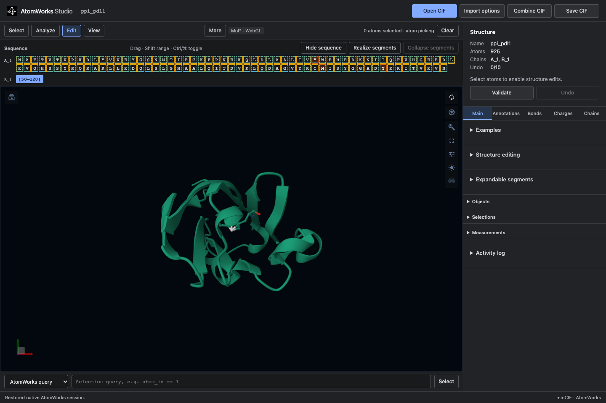

# AtomWorks Studio for VS Code

Inspect and edit molecular structures inside VS Code or Cursor. The editor
follows your active theme and connects to the same Python service as the browser.

1. Install Studio from its Python wheels in a Python 3.12 environment.
2. Install this `.vsix` with **Extensions → ··· → Install from VSIX…**.
3. Run **AtomWorks: Open Studio** from the Command Palette, then **Open CIF**.

The backend starts automatically using your selected Python environment, or the
`atomworks-studio` command on PATH. Use **AtomWorks: Select Python Interpreter**
if Studio is installed elsewhere. No terminal needs to stay open.

Opening Studio again reuses the backend and existing tab. The extension stops its
backend when the VS Code window closes or reloads. Save your CIF first.
Use **AtomWorks: Configure Studio Server** only to connect to an existing server;
clear the URL to restore automatic startup.

See the [VS Code guide](https://github.com/RosettaCommons/atomworks-studio/blob/main/docs/VSCODE.md)
for downloads, remote connections, and renderer selection.
